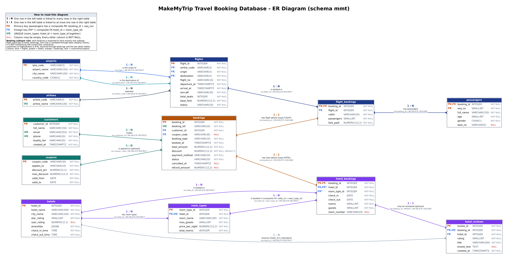

# Schema Design: MakeMyTrip Travel Booking Database

**Team:** T0051 · Section B · **Database:** PostgreSQL 15+ (verified on PostgreSQL 16) · **Schema:** `mmt`
**Phase 2 deliverable:** data dictionary, ER diagram, functional dependencies and normal forms, integrity-check results, data problems found.

**Contents:** 1 Overview · 2 ER diagram · 3 Relationships and cardinalities · 4 Data dictionary · 5 NULL vs NOT NULL · 6 UNIQUE constraints · 7 CHECK constraints · 8 Indexes that exist · 9 Functional dependencies and normal forms · 10 Derived and redundant columns · 11 Load and integrity checks · 12 Data problems found

---

## 1. Overview

We worked out 12 tables from the 12 seed CSV files and created them in the schema `mmt` (`CREATE SCHEMA mmt; SET search_path TO mmt;`). Table names and column names are identical to the CSV file names and headers, so the 30 workload queries run unchanged (all 25 reads and 5 writes were run against this schema without error).

| Group | Tables | Role |
|---|---|---|
| Reference data | `airports`, `airlines`, `coupons`, `hotels`, `room_types`, `customers` | Rarely change; referenced by other tables |
| Flights | `flights` | A *dated* flight: one row per flight number per day |
| Booking supertype | `bookings` | Data common to every booking |
| Booking subtypes | `flight_bookings`, `hotel_bookings`, `passengers` | Flight- or hotel-specific details; they share the key of `bookings` |
| Feedback | `hotel_reviews` | At most one review per hotel stay |

`01_schema.sql` contains only constraints (PK, FK, UNIQUE, NOT NULL, CHECK) and no other index, as Phase 2 requires.

---

## 2. ER diagram



Mermaid source of the same model:

```mermaid
erDiagram
    %% Booking subtype rule: each booking is expected to have exactly one subtype (flight_bookings or hotel_bookings).
    %% This is validated through data integrity checks; it is NOT enforced by the current DDL constraints.
    %% Composite FK: hotel_bookings(hotel_id, room_type_id) -> room_types(hotel_id, room_type_id).

    airports ||--o{ flights : "1:N is the origin of (origin, ON DELETE RESTRICT)"
    airports ||--o{ flights : "1:N is the destination of (destination, ON DELETE RESTRICT)"
    airlines ||--o{ flights : "1:N operates (airline_code, ON DELETE RESTRICT)"
    customers ||--o{ bookings : "1:N makes (customer_id, ON DELETE RESTRICT)"
    coupons |o--o{ bookings : "1:N is applied to (optional) (coupon_code, ON DELETE RESTRICT)"
    bookings ||--o| flight_bookings : "1:1 has flight details (type FLIGHT) (booking_id, ON DELETE CASCADE)"
    bookings ||--o| hotel_bookings : "1:1 has stay details (type HOTEL) (booking_id, ON DELETE CASCADE)"
    flights ||--o{ flight_bookings : "1:N is booked in (flight_id, ON DELETE RESTRICT)"
    flight_bookings ||--o{ passengers : "1:N has passengers (booking_id, ON DELETE CASCADE)"
    hotels ||--o{ room_types : "1:N has room types (hotel_id, ON DELETE RESTRICT)"
    hotels ||--o{ hotel_bookings : "1:N is booked in (hotel_id, ON DELETE RESTRICT)"
    room_types ||--o{ hotel_bookings : "1:N is booked in (composite FK: hotel_id + room_type_id) (hotel_id, room_type_id, ON DELETE RESTRICT)"
    hotels ||--o{ hotel_reviews : "1:N receives (hotel_id is redundant) (hotel_id, ON DELETE RESTRICT)"
    hotel_bookings ||--o| hotel_reviews : "1:1 may be reviewed (optional) (booking_id, UNIQUE, ON DELETE CASCADE)"

    airports {
        VARCHAR(3) iata_code PK "NOT NULL"
        VARCHAR(150) airport_name "NOT NULL"
        VARCHAR(100) city_name "NOT NULL"
        CHAR(2) country_code "NOT NULL"
    }
    airlines {
        VARCHAR(3) airline_code PK "NOT NULL"
        VARCHAR(100) airline_name UK "NOT NULL"
    }
    customers {
        INTEGER customer_id PK "NOT NULL"
        VARCHAR(150) full_name "NOT NULL"
        VARCHAR(255) email UK "NOT NULL"
        VARCHAR(20) phone UK "NOT NULL"
        VARCHAR(20) loyalty_tier "NOT NULL"
        TIMESTAMPTZ created_at "NOT NULL"
    }
    coupons {
        VARCHAR(30) coupon_code PK "NOT NULL"
        VARCHAR(10) applies_to "NOT NULL"
        NUMERIC(5,2) discount_pct "NOT NULL"
        NUMERIC(12,2) max_discount "NOT NULL"
        DATE valid_from "NOT NULL"
        DATE valid_to "NOT NULL"
    }
    flights {
        INTEGER flight_id PK "NOT NULL"
        VARCHAR(3) airline_code FK "NOT NULL"
        VARCHAR(3) origin FK "NOT NULL"
        VARCHAR(3) destination FK "NOT NULL"
        VARCHAR(10) flight_no "NOT NULL"
        TIMESTAMPTZ departure_at "NOT NULL"
        TIMESTAMPTZ arrival_at "NOT NULL"
        VARCHAR(30) aircraft "NOT NULL"
        INTEGER total_seats "NOT NULL"
        NUMERIC(12,2) base_fare "NOT NULL"
        VARCHAR(20) status "NOT NULL"
    }
    bookings {
        INTEGER booking_id PK "NOT NULL"
        VARCHAR(20) booking_ref UK "NOT NULL"
        INTEGER customer_id FK "NOT NULL"
        VARCHAR(30) coupon_code FK "NULL"
        VARCHAR(10) booking_type "NOT NULL"
        TIMESTAMPTZ booked_at "NOT NULL"
        NUMERIC(12,2) total_amount "NOT NULL"
        NUMERIC(12,2) discount "NOT NULL, DEFAULT 0"
        VARCHAR(20) payment_method "NOT NULL"
        VARCHAR(20) status "NOT NULL"
        TIMESTAMPTZ cancelled_at "NULL"
        NUMERIC(12,2) refund_amount "NULL"
    }
    flight_bookings {
        INTEGER booking_id PK, FK "NOT NULL"
        INTEGER flight_id FK "NOT NULL"
        VARCHAR(20) cabin "NOT NULL"
        SMALLINT passengers "NOT NULL"
        NUMERIC(12,2) fare_paid "NOT NULL"
    }
    passengers {
        INTEGER booking_id PK, FK "NOT NULL, part of composite PK"
        SMALLINT seq_no PK "NOT NULL, part of composite PK"
        VARCHAR(150) full_name "NOT NULL"
        SMALLINT age "NOT NULL"
        CHAR(1) gender "NOT NULL"
        VARCHAR(5) seat_no "NULL"
    }
    hotels {
        INTEGER hotel_id PK "NOT NULL"
        VARCHAR(200) hotel_name "NOT NULL"
        VARCHAR(100) city_name "NOT NULL"
        SMALLINT star_rating "NOT NULL"
        NUMERIC(2,1) user_rating "NULL"
        JSONB amenities "NOT NULL"
        TIME check_in_time "NOT NULL"
        TIME check_out_time "NOT NULL"
    }
    room_types {
        INTEGER room_type_id PK "NOT NULL"
        INTEGER hotel_id FK "NOT NULL, UNIQUE together with room_type_id"
        VARCHAR(100) room_name "NOT NULL"
        SMALLINT max_guests "NOT NULL"
        NUMERIC(12,2) price_per_night "NOT NULL"
        INTEGER total_rooms "NOT NULL"
    }
    hotel_bookings {
        INTEGER booking_id PK, FK "NOT NULL"
        INTEGER hotel_id FK "NOT NULL, composite FK (with room_type_id)"
        INTEGER room_type_id FK "NOT NULL, composite FK (with hotel_id)"
        DATE check_in "NOT NULL"
        DATE check_out "NOT NULL"
        SMALLINT rooms "NOT NULL"
        SMALLINT guests "NOT NULL"
        VARCHAR(20) room_number "NULL"
    }
    hotel_reviews {
        INTEGER review_id PK "NOT NULL"
        INTEGER booking_id FK, UK "NOT NULL, UNIQUE"
        INTEGER hotel_id FK "NOT NULL, redundant (derivable from booking)"
        SMALLINT rating "NOT NULL"
        VARCHAR(200) title "NOT NULL"
        TEXT review_text "NULL"
        TIMESTAMPTZ created_at "NOT NULL"
    }
```

Reading the notation: `||` exactly one · `o|` zero or one · `o{` zero or many · `|{` one or many.

---

## 3. Relationships and cardinalities

| # | Parent (one side) | Child (many side) | Cardinality | Implemented by | ON DELETE | Why |
|---|---|---|:---:|---|---|---|
| 1 | `airports` | `flights` (origin) | 1 : N | `flights.origin` → `airports.iata_code` | RESTRICT | Reference data; a flight must not lose its airport. |
| 2 | `airports` | `flights` (destination) | 1 : N | `flights.destination` → `airports.iata_code` | RESTRICT | Same as above. |
| 3 | `airlines` | `flights` | 1 : N | `flights.airline_code` → `airlines.airline_code` | RESTRICT | Same as above. |
| 4 | `customers` | `bookings` | 1 : N | `bookings.customer_id` → `customers.customer_id` | RESTRICT | Bookings are financial history and must never be destroyed by deleting a customer. |
| 5 | `coupons` | `bookings` | 1 : N (optional) | `bookings.coupon_code` → `coupons.coupon_code` (nullable) | RESTRICT | SET NULL would silently erase why a discount was given. |
| 6 | `bookings` | `flight_bookings` | 1 : 0..1 | shared key: `flight_bookings.booking_id` is PK and FK | CASCADE | The detail row has no meaning without its booking. |
| 7 | `bookings` | `hotel_bookings` | 1 : 0..1 | shared key: `hotel_bookings.booking_id` is PK and FK | CASCADE | Same as above. |
| 8 | `flights` | `flight_bookings` | 1 : N | `flight_bookings.flight_id` → `flights.flight_id` | RESTRICT | A flight that has bookings must not be deletable. |
| 9 | `flight_bookings` | `passengers` | 1 : N (≥ 1) | `passengers.booking_id` → `flight_bookings.booking_id` | CASCADE | A passenger has no meaning without the booking. |
| 10 | `hotels` | `room_types` | 1 : N | `room_types.hotel_id` → `hotels.hotel_id` | RESTRICT | Hotels are reference data. |
| 11 | `hotels` | `hotel_bookings` | 1 : N | `hotel_bookings.hotel_id` → `hotels.hotel_id` | RESTRICT | Booking history must survive. |
| 12 | `room_types` | `hotel_bookings` | 1 : N | composite FK `(hotel_id, room_type_id)` → `room_types(hotel_id, room_type_id)` | RESTRICT | Booking history must survive; the composite key also forces the room type to belong to the booked hotel. |
| 13 | `hotel_bookings` | `hotel_reviews` | 1 : 0..1 | `hotel_reviews.booking_id` FK + UNIQUE | CASCADE | A review has no meaning without its stay. |
| 14 | `hotels` | `hotel_reviews` | 1 : N | `hotel_reviews.hotel_id` → `hotels.hotel_id` | RESTRICT | Reviews are history; the column is redundant (section 10). |

SET NULL is not used. The only optional foreign key is `bookings.coupon_code` and it is RESTRICT for the reason in row 5.

**Many-to-many relationships**
- `customers` ↔ `flights` is M:N, resolved by `bookings` + `flight_bookings`.
- `customers` ↔ `hotels` is M:N, resolved by `bookings` + `hotel_bookings`.
- `bookings` is a supertype with two subtypes (`flight_bookings`, `hotel_bookings`), modelled as table-per-subtype with a shared primary key.

**Subtype rule.** "Exactly one subtype row per booking, matching `booking_type`" cannot be written as an ordinary CHECK (it needs to look at other tables). It is verified after loading in checks C3 and C4 (section 11).

---

## 4. Data dictionary

Legend: **PK** primary key · **FK** foreign key · **UQ** unique · **NN** not null · **CK** check.

### 4.1 `airports` (16 rows)

| Column | Type | Constraint | Why |
|---|---|---|---|
| `iata_code` | `VARCHAR(3)` | PK, CK `~ '^[A-Z]{3}$'` | A 3-letter IATA code is a stable natural key and is what `flights` refers to; no surrogate id is needed. |
| `airport_name` | `VARCHAR(150)` | NN | Descriptive name; always present. |
| `city_name` | `VARCHAR(100)` | NN | City served; always present. |
| `country_code` | `CHAR(2)` | NN, CK `~ '^[A-Z]{2}$'` | ISO country code, always exactly 2 characters. |

### 4.2 `airlines` (5 rows)

| Column | Type | Constraint | Why |
|---|---|---|---|
| `airline_code` | `VARCHAR(3)` | PK, CK `~ '^[A-Z0-9]{2,3}$'` | IATA airline codes are short and may contain digits (`6E`). |
| `airline_name` | `VARCHAR(100)` | NN, UQ | Each airline has a distinct name, so it is a candidate key. |

### 4.3 `customers` (40,000 rows)

| Column | Type | Constraint | Why |
|---|---|---|---|
| `customer_id` | `INTEGER` | PK | Surrogate key. |
| `full_name` | `VARCHAR(150)` | NN | Not unique (only 500 distinct names for 40,000 customers), so it cannot be a key. |
| `email` | `VARCHAR(255)` | NN, UQ, CK email pattern | Sign-in identifier and natural candidate key. Stored as supplied (mixed case), which is why R23 uses `lower(email)`. |
| `phone` | `VARCHAR(20)` | NN, UQ | Text, not a number: no arithmetic is done on it and it can have leading zeros or a `+91` prefix. All 40,000 values are unique. |
| `loyalty_tier` | `VARCHAR(20)` | NN, CK ∈ {BLUE, SILVER, GOLD, PLATINUM} | Closed set of tiers. |
| `created_at` | `TIMESTAMPTZ` | NN | The CSV carries a `+05:30` offset, so a timestamp with time zone is needed. |

### 4.4 `coupons` (30 rows)

| Column | Type | Constraint | Why |
|---|---|---|---|
| `coupon_code` | `VARCHAR(30)` | PK | Natural key referenced by `bookings.coupon_code`. |
| `applies_to` | `VARCHAR(10)` | NN, CK ∈ {ALL, FLIGHT, HOTEL} | Which booking type the coupon is valid for. |
| `discount_pct` | `NUMERIC(5,2)` | NN, CK `> 0 AND <= 100` | A percentage; exact decimal, not float. |
| `max_discount` | `NUMERIC(12,2)` | NN, CK `> 0` | Money cap; exact decimal. |
| `valid_from`, `valid_to` | `DATE` | NN, CK `valid_to >= valid_from` | Validity window; no time of day is needed. |

### 4.5 `flights` (13,848 rows)

| Column | Type | Constraint | Why |
|---|---|---|---|
| `flight_id` | `INTEGER` | PK | One row per *dated* flight. `flight_no` repeats every day (24 distinct values for 13,848 flights), so it cannot be the key. |
| `airline_code` | `VARCHAR(3)` | NN, FK → `airlines`, RESTRICT | Operating airline. |
| `flight_no` | `VARCHAR(10)` | NN, CK `~ '^[A-Z0-9]{2,3}-[0-9]{3}$'` | Format seen in the data, e.g. `6E-137`. |
| `origin`, `destination` | `VARCHAR(3)` | NN, FK → `airports`, RESTRICT, CK `origin <> destination` | Two foreign keys to the same table; a flight cannot start and end at the same airport. |
| `departure_at`, `arrival_at` | `TIMESTAMPTZ` | NN, CK `arrival_at > departure_at` | The CSV has a time-zone offset; the CHECK enforces time order. |
| `aircraft` | `VARCHAR(30)` | NN | Aircraft model name (3 models in the data). |
| `total_seats` | `INTEGER` | NN, CK `> 0` | Capacity of this flight. |
| `base_fare` | `NUMERIC(12,2)` | NN, CK `> 0` | Money: exact decimal. |
| `status` | `VARCHAR(20)` | NN, CK ∈ {SCHEDULED, DELAYED, DEPARTED, LANDED, CANCELLED} | Closed set of statuses. |

### 4.6 `hotels` (3,000 rows)

| Column | Type | Constraint | Why |
|---|---|---|---|
| `hotel_id` | `INTEGER` | PK | Surrogate key. |
| `hotel_name` | `VARCHAR(200)` | NN | Name. Unique in this data, but not declared UNIQUE because different hotels can legitimately share a name. |
| `city_name` | `VARCHAR(100)` | NN | City (18 distinct), used as a search filter. |
| `star_rating` | `SMALLINT` | NN, CK 1–5 | Small whole number. |
| `user_rating` | `NUMERIC(2,1)` | **NULL allowed**, CK NULL or 1–5 | Guest rating with one decimal. NULL for 134 hotels (reason in section 5). |
| `amenities` | `JSONB` | NN, CK `jsonb_typeof(amenities) = 'object'` | **A JSON object of 7 boolean flags** (`gym, spa, pool, wifi, parking, breakfast, pet_friendly`); all 3,000 hotels have all 7 keys with boolean values. JSONB (binary JSON) is used so it can be queried with `->>` (R03) and indexed later. |
| `check_in_time`, `check_out_time` | `TIME` | NN | Time of day only, no date. |

### 4.7 `room_types` (9,000 rows)

| Column | Type | Constraint | Why |
|---|---|---|---|
| `room_type_id` | `INTEGER` | PK | Surrogate key. |
| `hotel_id` | `INTEGER` | NN, FK → `hotels`, RESTRICT | Owning hotel. |
| `room_name` | `VARCHAR(100)` | NN | Standard Room / Deluxe Room / Suite. |
| `max_guests` | `SMALLINT` | NN, CK `> 0` | Capacity per room. |
| `price_per_night` | `NUMERIC(12,2)` | NN, CK `> 0` | Money: exact decimal. |
| `total_rooms` | `INTEGER` | NN, CK `> 0` | Inventory used by R04. |
| *(constraint)* | | `UNIQUE (hotel_id, room_type_id)` | Logically redundant (the PK is already unique), but PostgreSQL needs a unique key on exactly these two columns so that `hotel_bookings` can reference the pair. |

### 4.8 `bookings` (144,792 rows)

| Column | Type | Constraint | Why |
|---|---|---|---|
| `booking_id` | `INTEGER` | PK | Internal key. |
| `booking_ref` | `VARCHAR(20)` | NN, UQ, CK `~ '^[A-Z0-9]{8}$'` | Customer-facing reference such as `MMA7772F`; a candidate key and the lookup column of R06 and W03. |
| `customer_id` | `INTEGER` | NN, FK → `customers`, RESTRICT | Owner of the booking. |
| `booking_type` | `VARCHAR(10)` | NN, CK ∈ {FLIGHT, HOTEL} | Discriminator of the supertype. |
| `booked_at` | `TIMESTAMPTZ` | NN | Time of booking, with offset. |
| `total_amount` | `NUMERIC(12,2)` | NN, CK `> 0` | Net amount payable (after discount). |
| `coupon_code` | `VARCHAR(30)` | **NULL allowed**, FK → `coupons`, RESTRICT | NULL when no coupon was used. |
| `discount` | `NUMERIC(12,2)` | NN, DEFAULT 0, CK `0 <= discount <= total_amount` | 0 when there is no coupon. |
| `payment_method` | `VARCHAR(20)` | NN, CK ∈ {CARD, EMI, NETBANKING, UPI, WALLET} | Closed set. |
| `status` | `VARCHAR(20)` | NN, CK ∈ {PENDING_PAYMENT, CONFIRMED, COMPLETED, CANCELLED} | Booking life cycle. |
| `cancelled_at` | `TIMESTAMPTZ` | **NULL allowed** | Set only for cancelled bookings. |
| `refund_amount` | `NUMERIC(12,2)` | **NULL allowed**, CK NULL or `0 <= refund <= total_amount` | Set only for cancelled bookings; a refund can never exceed what was paid. |

Cross-column rules: `chk_booking_cancellation` (status = `CANCELLED` ⇔ `cancelled_at` and `refund_amount` are both present) and `chk_booking_coupon_discount` (no coupon ⇒ discount = 0).

### 4.9 `flight_bookings` (84,899 rows)

| Column | Type | Constraint | Why |
|---|---|---|---|
| `booking_id` | `INTEGER` | PK, FK → `bookings`, CASCADE | PK and FK at once, so a booking has at most one flight-detail row. |
| `flight_id` | `INTEGER` | NN, FK → `flights`, RESTRICT | The booked flight. |
| `cabin` | `VARCHAR(20)` | NN, CK ∈ {ECONOMY, PREMIUM, BUSINESS} | Closed set. |
| `passengers` | `SMALLINT` | NN, CK `> 0` | Passenger count (derived, see section 10). |
| `fare_paid` | `NUMERIC(12,2)` | NN, CK `> 0` | Gross fare before the coupon (derived, see section 10). |

### 4.10 `passengers` (163,380 rows)

| Column | Type | Constraint | Why |
|---|---|---|---|
| `booking_id` | `INTEGER` | PK (part), FK → `flight_bookings`, CASCADE | Parent flight booking. |
| `seq_no` | `SMALLINT` | PK (part), CK `> 0` | Passenger number inside the booking (1, 2, 3…). **The primary key is the composite `(booking_id, seq_no)`.** No single column is a key: names and ages repeat and a seat is not unique. |
| `full_name` | `VARCHAR(150)` | NN | Every passenger must be named for the manifest (R07). |
| `age` | `SMALLINT` | NN, CK `>= 0` | Small whole number; observed range 1–75. |
| `gender` | `CHAR(1)` | NN, CK ∈ {M, F, X} | Single-letter code. |
| `seat_no` | `VARCHAR(5)` | **NULL allowed**, CK NULL or `~ '^[0-9]{1,2}[A-F]$'` | Assigned at web check-in, so NULL means "no seat yet" (section 5). Format like `16D`. |

### 4.11 `hotel_bookings` (59,893 rows)

| Column | Type | Constraint | Why |
|---|---|---|---|
| `booking_id` | `INTEGER` | PK, FK → `bookings`, CASCADE | Shared key, as in `flight_bookings`. |
| `hotel_id` | `INTEGER` | NN, FK → `hotels`, RESTRICT | The booked hotel. Redundant with the room type's hotel (section 10) but kept because R15 groups by hotel directly. |
| `room_type_id` | `INTEGER` | NN, composite FK `(hotel_id, room_type_id)` → `room_types`, RESTRICT | The composite key guarantees the room type belongs to the booked hotel. |
| `check_in`, `check_out` | `DATE` | NN, CK `check_out > check_in` | Dates, not timestamps; a stay has at least one night. |
| `rooms`, `guests` | `SMALLINT` | NN, CK `> 0` | Small whole counts. |
| `room_number` | `VARCHAR(20)` | **NULL allowed** | Assigned at check-in (section 5). Text, because a room label is an identifier, not a quantity. |

### 4.12 `hotel_reviews` (15,913 rows)

| Column | Type | Constraint | Why |
|---|---|---|---|
| `review_id` | `INTEGER` | PK | Surrogate key; a review has no natural key of its own. |
| `booking_id` | `INTEGER` | NN, UQ, FK → `hotel_bookings`, CASCADE | UNIQUE allows at most one review per stay; it is a second candidate key. |
| `hotel_id` | `INTEGER` | NN, FK → `hotels`, RESTRICT | Redundant copy of the booking's hotel, kept for hotel pages (section 10). |
| `rating` | `SMALLINT` | NN, CK 1–5 | Star score; a review without a rating is meaningless. |
| `title` | `VARCHAR(200)` | NN | Every review has a title (0 NULLs in the data). |
| `review_text` | `TEXT` | **NULL allowed** | Free text of unlimited length; NULL when the guest wrote only a title and rating. |
| `created_at` | `TIMESTAMPTZ` | NN | When the review was written. |

---

## 5. NULL vs NOT NULL: when and why a column is empty

Counts come from the loaded database. Every column not listed here has no NULLs in the seed data and is declared `NOT NULL`.

| Column | NULL rows | When it is NULL | Rule found in the data |
|---|---:|---|---|
| `bookings.coupon_code` | 127,144 | The customer used no coupon | NULL ⇔ `discount = 0` (0 exceptions in both directions) |
| `bookings.cancelled_at` | 133,298 | The booking is not cancelled | NULL for exactly the 133,298 non-`CANCELLED` bookings |
| `bookings.refund_amount` | 133,298 | The booking is not cancelled | Same rows. All 11,494 refunds equal exactly 70% of `total_amount`. |
| `passengers.seat_no` | 21,612 | Seat not assigned yet (web check-in not done) | CONFIRMED: 5,322 of 5,322 have no seat. PENDING_PAYMENT: 124 of 125. COMPLETED: 14,450 of 145,029. CANCELLED: 1,716 of 12,904. |
| `hotel_bookings.room_number` | 6,815 | The room is given at check-in, which has not happened (or never will) | NULL for all 4,810 CANCELLED, all 1,971 CONFIRMED (every CONFIRMED stay checks in on or after 1 Jul 2026) and all 34 PENDING_PAYMENT. **0 of 53,078 COMPLETED stays are NULL.** |
| `hotels.user_rating` | 134 | The listing score is missing in the export | **Not** explained by "no reviews": 133 of the 134 hotels have reviews and all 134 have bookings. The NULLs are spread over all star ratings and cities. See problem 9 in section 12. |
| `hotel_reviews.review_text` | 4,812 | The guest wrote only a title and a rating | No empty strings (0): NULL is used consistently |

---

## 6. UNIQUE constraints (natural candidate keys)

| Table | Column(s) | Why |
|---|---|---|
| `airlines` | `airline_name` | Distinct for all 5 airlines |
| `customers` | `email` | Sign-in identifier; no duplicates even ignoring case (40,000 distinct `lower(email)`) |
| `customers` | `phone` | One customer per phone number |
| `bookings` | `booking_ref` | Customer-facing reference identifies exactly one booking |
| `hotel_reviews` | `booking_id` | At most one review per stay |
| `room_types` | `(hotel_id, room_type_id)` | Target of the composite foreign key from `hotel_bookings` |

---

## 7. CHECK constraints (41 in total; the README asks for at least 12)

| Table | Constraint | Rule |
|---|---|---|
| airports | `chk_airport_iata` | IATA code is 3 uppercase letters |
| airports | `chk_airport_country` | Country code is 2 uppercase letters |
| airlines | `chk_airline_code` | 2–3 uppercase letters/digits |
| customers | `chk_customer_email` | `local@domain.tld` pattern, no spaces |
| customers | `chk_customer_loyalty` | BLUE / SILVER / GOLD / PLATINUM |
| coupons | `chk_coupon_applies` | ALL / FLIGHT / HOTEL |
| coupons | `chk_coupon_discount` | 0 < percentage ≤ 100 |
| coupons | `chk_coupon_max_discount` | cap > 0 |
| coupons | `chk_coupon_dates` | `valid_to >= valid_from` |
| flights | `chk_flight_number` | format `XX-123` |
| flights | `chk_flight_route` | origin ≠ destination |
| flights | `chk_flight_time` | arrival after departure |
| flights | `chk_flight_seats` | seats > 0 |
| flights | `chk_flight_fare` | fare > 0 |
| flights | `chk_flight_status` | 5 allowed statuses |
| hotels | `chk_hotel_star_rating` | 1–5 |
| hotels | `chk_hotel_user_rating` | NULL or 1–5 |
| hotels | `chk_hotel_amenities` | the JSON value is an object |
| room_types | `chk_room_max_guests` | > 0 |
| room_types | `chk_room_price` | > 0 |
| room_types | `chk_room_total` | > 0 |
| bookings | `chk_booking_reference` | 8 uppercase letters/digits |
| bookings | `chk_booking_type` | FLIGHT / HOTEL |
| bookings | `chk_booking_amount` | total > 0 |
| bookings | `chk_booking_discount` | 0 ≤ discount ≤ total |
| bookings | `chk_booking_coupon_discount` | no coupon ⇒ discount = 0 |
| bookings | `chk_booking_payment` | 5 payment methods |
| bookings | `chk_booking_status` | 4 statuses |
| bookings | `chk_booking_cancellation` | CANCELLED ⇔ `cancelled_at` and `refund_amount` present |
| bookings | `chk_booking_refund` | refund between 0 and `total_amount` |
| flight_bookings | `chk_flight_cabin` | ECONOMY / PREMIUM / BUSINESS |
| flight_bookings | `chk_flight_passengers` | passengers > 0 |
| flight_bookings | `chk_flight_fare_paid` | fare > 0 |
| passengers | `chk_passenger_sequence` | seq_no > 0 |
| passengers | `chk_passenger_age` | age ≥ 0 |
| passengers | `chk_passenger_gender` | M / F / X |
| passengers | `chk_passenger_seat` | NULL or seat like `16D` |
| hotel_bookings | `chk_hotel_booking_dates` | check-out after check-in |
| hotel_bookings | `chk_hotel_booking_rooms` | rooms > 0 |
| hotel_bookings | `chk_hotel_booking_guests` | guests > 0 |
| hotel_reviews | `chk_review_rating` | 1–5 |

---

## 8. Indexes that exist after Phase 2

Only the 18 indexes that PostgreSQL creates automatically for PRIMARY KEY and UNIQUE constraints exist (read from `pg_indexes`). No other index has been created, so the Phase 3 baseline reflects an untuned database.

| Table | Indexes |
|---|---|
| airports | `airports_pkey` |
| airlines | `airlines_pkey`, `airlines_airline_name_key` |
| customers | `customers_pkey`, `customers_email_key`, `customers_phone_key` |
| coupons | `coupons_pkey` |
| flights | `flights_pkey` |
| hotels | `hotels_pkey` |
| room_types | `room_types_pkey`, `uq_room_hotel_pair` |
| bookings | `bookings_pkey`, `bookings_booking_ref_key` |
| flight_bookings | `flight_bookings_pkey` |
| passengers | `pk_passengers` (on `booking_id, seq_no`) |
| hotel_bookings | `hotel_bookings_pkey` |
| hotel_reviews | `hotel_reviews_pkey`, `hotel_reviews_booking_id_key` |

---

## 9. Functional dependencies and normal forms

`A → B` means A determines B. "Verified" means we checked on the loaded data that no counter-example exists.

| Table | Candidate keys | Functional dependencies | Normal form |
|---|---|---|---|
| `airports` | `iata_code` | `iata_code → airport_name, city_name, country_code` | **BCNF** |
| `airlines` | `airline_code`, `airline_name` | `airline_code ↔ airline_name` | **BCNF** |
| `customers` | `customer_id`, `email`, `phone` | `customer_id → full_name, email, phone, loyalty_tier, created_at`; `email → customer_id`; `phone → customer_id` | **BCNF** (every determinant is a key) |
| `coupons` | `coupon_code` | `coupon_code → applies_to, discount_pct, max_discount, valid_from, valid_to` | **BCNF** |
| `flights` | `flight_id` | `flight_id → all other columns`. Also observed (verified, 0 exceptions): `aircraft → total_seats` (3 models) and `flight_no → airline_code, origin, destination` (24 flight numbers). | **2NF, not 3NF/BCNF** if those observed rules are business rules. `aircraft` and `flight_no` are not keys, so `flight_id → aircraft → total_seats` is transitive. A fully normalised design would add `aircraft_models(aircraft, total_seats)` and `routes(flight_no, airline_code, origin, destination)`. We keep them on `flights` on purpose: the CSV and the hottest queries (R01, R02, R08) need these columns on `flights`, and the split would add joins. Real aircraft of one model can also have different seat layouts, so `total_seats` may legitimately vary per flight. |
| `hotels` | `hotel_id` | `hotel_id → hotel_name, city_name, star_rating, user_rating, amenities, check_in_time, check_out_time` | **BCNF**. `amenities` is a single JSONB value, so it is atomic for 1NF. (A separate `hotel_amenities` table would be the fully relational alternative.) |
| `room_types` | `room_type_id` | `room_type_id → hotel_id, room_name, max_guests, price_per_night, total_rooms` | **BCNF** |
| `bookings` | `booking_id`, `booking_ref` | `booking_id → all columns`; `booking_ref → booking_id`. Derived (not a dependency on a non-key): `booking_type` follows from which subtype row exists; `discount` follows from the coupon and the gross amount (`discount = least(pct × gross, max_discount)`, holds for all 17,648 coupon bookings). | **BCNF** with respect to the declared keys |
| `flight_bookings` | `booking_id` | `booking_id → flight_id, cabin, passengers, fare_paid` | **BCNF** inside the table; `passengers` and `fare_paid` are derivable from other tables (section 10) |
| `passengers` | `(booking_id, seq_no)` | `(booking_id, seq_no) → full_name, age, gender, seat_no`. Full dependency on the whole key; no partial dependency on `booking_id` alone. | **BCNF** |
| `hotel_bookings` | `booking_id` | `booking_id → hotel_id, room_type_id, check_in, check_out, rooms, guests, room_number`. Also `room_type_id → hotel_id` (verified, 0 exceptions, and enforced by the composite FK). | **2NF, not 3NF.** `booking_id → room_type_id → hotel_id` is transitive because `room_type_id` is not a key here. `hotel_id` is redundant. It is kept because the CSV has it and R15 uses it; the composite FK makes an inconsistency impossible. |
| `hotel_reviews` | `review_id`, `booking_id` | both keys → all other columns. Also `booking_id → hotel_id` via `hotel_bookings` (verified, 0 mismatches). | **BCNF** within its own columns; `hotel_id` is a cross-table redundancy (section 10) |

**Summary:** 10 of 12 tables are in BCNF. `flights` and `hotel_bookings` are only in 2NF; both are intentional, documented denormalisations.

---

## 10. Derived and redundant columns

| Column | Derived from | Verified on the data | Keep? | Justification |
|---|---|---|---|---|
| `flight_bookings.fare_paid` | `bookings.total_amount + bookings.discount` | **84,899 / 84,899 match.** `fare_paid` is the *gross* fare before the coupon; `total_amount` is the *net* amount. | Keep | It is in the source export and records the pre-discount fare directly. Risk: it can drift if `discount` changes. |
| `flight_bookings.passengers` | number of `passengers` rows of that booking | **0 mismatches** over 84,899 | Keep | R01, R08 and R19 sum it directly; counting rows would force a join to the largest child table. It must be updated together with the passenger rows. |
| `hotel_reviews.hotel_id` | `hotel_bookings.hotel_id` via `booking_id` | **0 mismatches** over 15,913 | Keep | R18 and R24 group reviews by hotel without joining `hotel_bookings`. A plain FK cannot enforce equality across the two paths, so a trigger or a periodic check (C5) is needed. |
| `hotel_bookings.hotel_id` | `room_types.hotel_id` via `room_type_id` | 0 exceptions | Keep | R15 joins on it directly. The composite FK guarantees consistency. |
| `bookings.booking_type` | which subtype table has the row | 0 mismatches over 144,792 | Keep | Used as a filter and group column (R05, R12, R16); avoids probing both subtype tables. |
| `bookings.discount` | coupon percentage, cap and gross amount | consistent for all 17,648 coupon bookings | Keep | Audit trail: stays correct even if the coupon later changes. |
| `flights.total_seats` | aircraft model | 3 models, 1 seat count each | Keep | See section 9. |

---

## 11. Load and integrity checks

### 11.1 How the data was loaded

`sql/01_schema.sql` was run on an empty database, then `sql/02_load_data.sql` with `ON_ERROR_STOP=1`. It uses `\copy` in an order that satisfies the foreign keys:
`airports → airlines → customers → coupons → flights → hotels → room_types → bookings → flight_bookings → passengers → hotel_bookings → hotel_reviews`, followed by `ANALYZE`.

```
SET
COPY 16
COPY 5
COPY 40000
COPY 30
COPY 13848
COPY 3000
COPY 9000
COPY 144792
COPY 84899
COPY 163380
COPY 59893
COPY 15913
ANALYZE
```

The load finished with **no errors**. Every constraint is validated (`SELECT count(*) FROM pg_constraint ... WHERE NOT convalidated` returns 0), so **no constraint had to be relaxed**: all 12 files satisfy the 12 PKs, 14 FKs, 6 UNIQUEs and 41 CHECKs.

### 11.2 Row counts

```sql
SELECT 'airports' t, count(*) FROM airports UNION ALL SELECT 'airlines', count(*) FROM airlines
UNION ALL SELECT 'flights', count(*) FROM flights UNION ALL SELECT 'hotels', count(*) FROM hotels
UNION ALL SELECT 'room_types', count(*) FROM room_types UNION ALL SELECT 'customers', count(*) FROM customers
UNION ALL SELECT 'coupons', count(*) FROM coupons UNION ALL SELECT 'bookings', count(*) FROM bookings
UNION ALL SELECT 'flight_bookings', count(*) FROM flight_bookings UNION ALL SELECT 'passengers', count(*) FROM passengers
UNION ALL SELECT 'hotel_bookings', count(*) FROM hotel_bookings UNION ALL SELECT 'hotel_reviews', count(*) FROM hotel_reviews;
```

```
        t        | count
-----------------+--------
 airlines        |      5
 airports        |     16
 coupons         |     30
 hotels          |   3000
 room_types      |   9000
 flights         |  13848
 hotel_reviews   |  15913
 customers       |  40000
 hotel_bookings  |  59893
 flight_bookings |  84899
 passengers      | 163380
 bookings        | 144792
```

| Table | Expected (README) | Loaded | Match |
|---|---:|---:|:--:|
| airports | 16 | 16 | ✅ |
| airlines | 5 | 5 | ✅ |
| flights | 13,848 | 13,848 | ✅ |
| hotels | 3,000 | 3,000 | ✅ |
| room_types | 9,000 | 9,000 | ✅ |
| customers | 40,000 | 40,000 | ✅ |
| coupons | 30 | 30 | ✅ |
| bookings | 144,792 | 144,792 | ✅ |
| flight_bookings | 84,899 | 84,899 | ✅ |
| passengers | 163,380 | 163,380 | ✅ |
| hotel_bookings | 59,893 | 59,893 | ✅ |
| hotel_reviews | 15,913 | 15,913 | ✅ |

### 11.3 Integrity checks

All checks were run with the session time zone set to `Asia/Kolkata`. A result of 0 violations is the healthy outcome.

**C1. Every flight booking has exactly `passengers` passenger rows**
```sql
SELECT count(*) AS c1_mismatch
FROM flight_bookings fb
WHERE fb.passengers <> (SELECT count(*) FROM passengers p WHERE p.booking_id = fb.booking_id);
```
```
 c1_mismatch
-------------
           0
```

**C2. No flight was booked after it departed**
```sql
SELECT count(*) AS c2_booked_after_departure
FROM bookings b
JOIN flight_bookings fb USING (booking_id)
JOIN flights f USING (flight_id)
WHERE b.booked_at > f.departure_at;
```
```
 c2_booked_after_departure
---------------------------
                         0
```

**C3. A booking is a flight booking or a hotel booking, never both and never neither**
```sql
SELECT count(*) FILTER (WHERE fb.booking_id IS NOT NULL AND hb.booking_id IS NOT NULL) AS both_subtypes,
       count(*) FILTER (WHERE fb.booking_id IS NULL AND hb.booking_id IS NULL)         AS neither
FROM bookings b
LEFT JOIN flight_bookings fb USING (booking_id)
LEFT JOIN hotel_bookings hb USING (booking_id);
```
```
 both_subtypes | neither
---------------+---------
             0 |       0
```

**C4. `booking_type` agrees with the subtype table**
```sql
SELECT count(*) AS c4_mismatch
FROM bookings b
LEFT JOIN flight_bookings fb USING (booking_id)
LEFT JOIN hotel_bookings hb USING (booking_id)
WHERE (b.booking_type = 'FLIGHT' AND fb.booking_id IS NULL)
   OR (b.booking_type = 'HOTEL'  AND hb.booking_id IS NULL);
```
```
 c4_mismatch
-------------
           0
```
(84,899 FLIGHT bookings and 59,893 HOTEL bookings: equal to the subtype row counts.)

**C5. A review's `hotel_id` equals the hotel of its booking**
```sql
SELECT count(*) AS c5_mismatch
FROM hotel_reviews r JOIN hotel_bookings hb USING (booking_id)
WHERE r.hotel_id <> hb.hotel_id;
```
```
 c5_mismatch
-------------
           0
```

**C6. A booking is never cancelled before it was made, and a refund never exceeds the amount**
```sql
SELECT count(*) FILTER (WHERE cancelled_at < booked_at)    AS cancel_before_booking,
       count(*) FILTER (WHERE refund_amount > total_amount) AS refund_gt_total
FROM bookings;
```
```
 cancel_before_booking | refund_gt_total
-----------------------+-----------------
                     0 |               0
```

**C7. No flight is sold above its capacity (non-cancelled bookings)**
```sql
SELECT count(*) AS c7_overbooked_flights FROM (
  SELECT f.flight_id
  FROM flights f
  JOIN flight_bookings fb USING (flight_id)
  JOIN bookings b USING (booking_id)
  WHERE b.status <> 'CANCELLED'
  GROUP BY f.flight_id, f.total_seats
  HAVING sum(fb.passengers) > f.total_seats) x;
```
```
 c7_overbooked_flights
-----------------------
                     0
```

**C8. No hotel booking asks for more rooms than the room type owns**
```sql
SELECT count(*) AS c8_too_many_rooms
FROM hotel_bookings hb JOIN room_types rt USING (room_type_id)
WHERE hb.rooms > rt.total_rooms;
```
```
 c8_too_many_rooms
-------------------
                 0
```

**C9. Only completed stays are reviewed, and never before check-out**
```sql
SELECT count(*) FILTER (WHERE b.status <> 'COMPLETED')            AS not_completed,
       count(*) FILTER (WHERE r.created_at::date < hb.check_out)  AS before_checkout
FROM hotel_reviews r
JOIN hotel_bookings hb USING (booking_id)
JOIN bookings b USING (booking_id);
```
```
 not_completed | before_checkout
---------------+-----------------
             0 |               0
```

**C10. `fare_paid = total_amount + discount` for flight bookings**
```sql
SELECT count(*) FILTER (WHERE fb.fare_paid = b.total_amount + b.discount) AS matching,
       count(*) AS total
FROM flight_bookings fb JOIN bookings b USING (booking_id);
```
```
 matching | total
----------+-------
    84899 | 84899
```

**C11. A seat is not given twice inside the same booking**
```sql
SELECT count(*) AS c11_duplicate_seat_in_booking FROM (
  SELECT 1 FROM passengers WHERE seat_no IS NOT NULL
  GROUP BY booking_id, seat_no HAVING count(*) > 1) x;
```
```
 c11_duplicate_seat_in_booking
-------------------------------
                             0
```

All 11 checks pass. The three checks that do **not** pass are data problems and are listed in section 12 (problems 1, 2 and 3).

---

## 12. Data problems found

| # | Problem | Evidence (query result) | What we did |
|---|---|---|---|
| 1 | **R13 returns no rows because of NULL handling.** `bookings.coupon_code` has 127,144 NULLs, and `x NOT IN (list containing NULL)` is never true, so the query returns 0 rows. 10 coupons are really unused: `DIWALI29, FIRSTTRIP26, FLYNOW21, GOAFEST23, HDFCFLY27, ICICISTAY28, MMTSUPER30, MONSOON24, STAYHAPPY22, WEEKEND25`. | `NOT IN` → **0** rows; `NOT EXISTS` → **10** rows | The schema keeps `coupon_code` nullable (correct modelling). The query itself is not changed in Phase 2. |
| 2 | **The same seat is given to more than one passenger on a flight.** A `UNIQUE (flight_id, seat_no)` rule is therefore impossible. | `SELECT count(*) FROM (SELECT 1 FROM passengers p JOIN flight_bookings fb USING (booking_id) WHERE seat_no IS NOT NULL GROUP BY fb.flight_id, p.seat_no HAVING count(*) > 1) x;` → **21,251** (flight, seat) pairs | Not enforced. Seat uniqueness is checked only inside one booking (C11). |
| 3 | **Guests above room capacity.** Some hotel bookings have more guests than `max_guests × rooms` (3 guests in 1 room whose `max_guests` is 2). | `... WHERE hb.guests > rt.max_guests * hb.rooms` → **9,994** hotel bookings | No CHECK added (it would reject valid seed rows). Reported only. |
| 4 | **`fare_paid` is gross, `total_amount` is net.** The tempting test `fare_paid = total_amount − discount` matches only the 74,836 bookings without a coupon. | C10: `fare_paid = total_amount + discount` for 84,899 / 84,899 | Both columns kept (section 10). |
| 5 | **Every refund is exactly 70% of `total_amount`** (11,494 of 11,494 cancellations); there are no partial or full refunds. | `count(*) FILTER (WHERE refund_amount = round(total_amount * 0.7, 2))` = 11,494 of 11,494 cancelled | The general rule `refund ≤ total_amount` is kept as the CHECK. |
| 6 | **The snapshot date is 30 Jun 2026**, so status values depend on time. All 97 PENDING_PAYMENT bookings were made on 30 Jun 2026. Flights before 30 Jun are LANDED (12,835) or CANCELLED (245); on 30 Jun they are DELAYED (6), DEPARTED (14) or SCHEDULED (4); after 30 Jun all 744 are SCHEDULED. | `min/max(booked_at::date)` of pending = 2026-06-30 | Explains R08, R10, R11 and W04. No schema change. |
| 7 | **Emails have mixed case** (e.g. `@Rediffmail.com`). All 40,000 differ from `lower(email)`, but there are no case-insensitive duplicates (40,000 distinct lowercased values). | `count(DISTINCT lower(email))` = 40,000; `count(*) FILTER (WHERE email <> lower(email))` = 40,000 | `email` is stored as supplied; R23 must search on `lower(email)`. |
| 8 | **Seats are missing even on completed and cancelled bookings** (14,450 of 145,029 passengers on COMPLETED bookings, 1,716 of 12,904 on CANCELLED). | section 5 | `seat_no` must stay nullable. |
| 9 | **`hotels.user_rating` is NULL for 134 hotels (4.5%), and this is not "no reviews yet".** 133 of the 134 have reviews, all 134 have bookings, and they are spread across all star ratings and cities. `user_rating` also does not track the reviews in the data (correlation with the average `hotel_reviews.rating` is about −0.01). | counts in section 5 | Column stays nullable. R03 uses `NULLS LAST`, so unrated hotels sort at the end. |
| 10 | **Reference data is very repetitive:** only 24 distinct `flight_no` values for 13,848 flights, 3 aircraft models, and 3 `room_name` values for all 9,000 room types. | `count(DISTINCT ...)` | Explains the two non-3NF dependencies in section 9. |
| 11 | **Names are not unique** (500 distinct names among 40,000 customers). | `count(DISTINCT full_name)` = 500 | `customer_id` is the key; `email` and `phone` are the candidate keys. |
